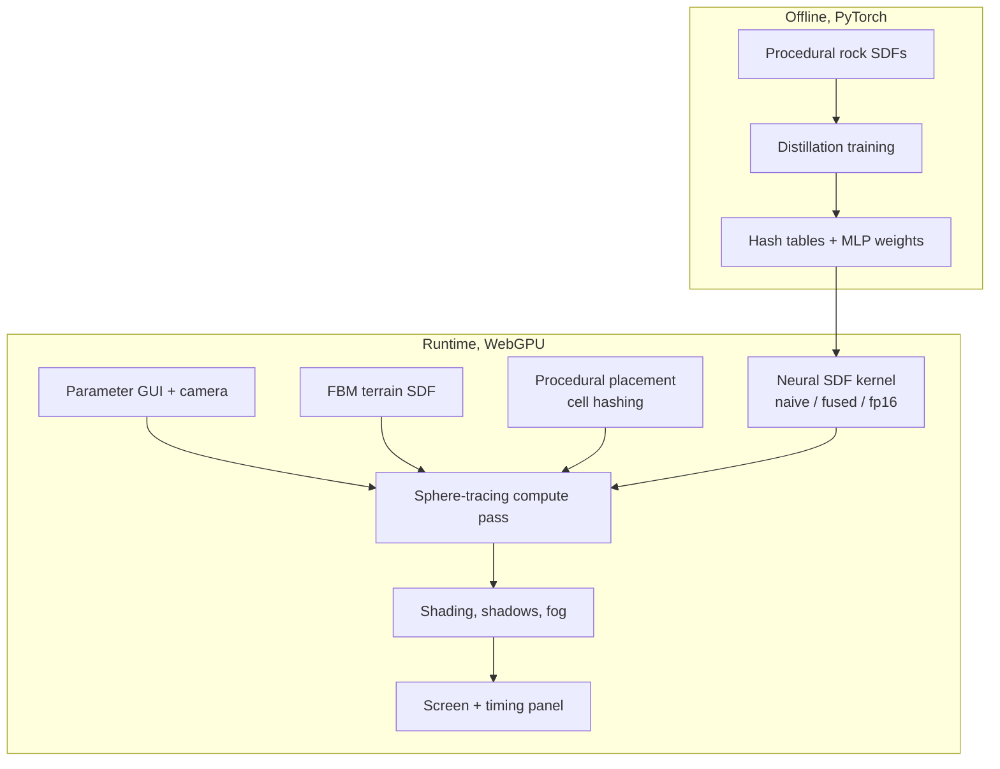
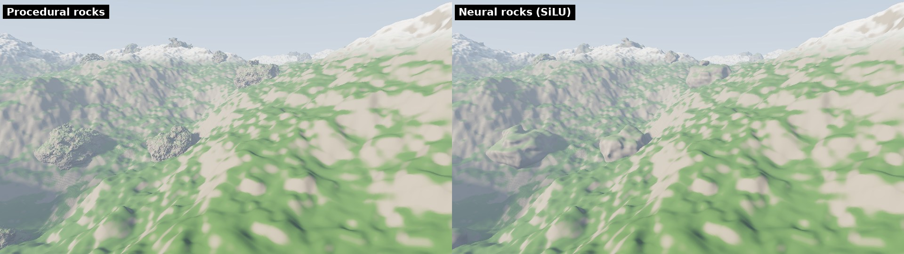
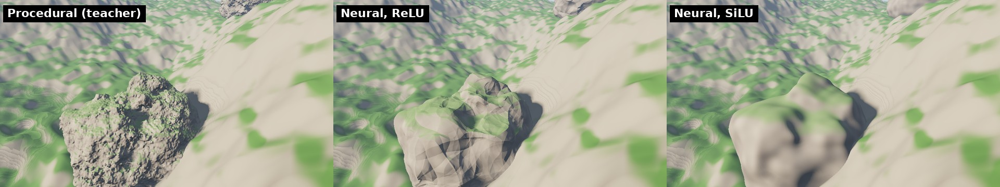

# Neural-Procedural Terrain in WebGPU

CIS 5660 Fall 2026 Final Project — Xuan Zhu

## Design Doc

### Introduction
Procedural terrain built from noise and signed distance functions (SDFs) can produce infinite, detailed worlds, but rich detail is expensive: every ray-marching step must evaluate many octaves of noise. Neural fields (e.g. Instant-NGP) take the opposite approach and store detail in a small neural network that can be queried quickly on the GPU.

This project combines the two. An infinite FBM terrain is generated procedurally, and procedurally placed rocks are represented as **neural SDFs**: their expensive multi-octave procedural shapes are distilled into tiny neural networks that are evaluated by **custom, hand-optimized WebGPU compute kernels**. The project sits at the meeting point of procedural graphics and GPU/ML systems, which is the area I want to grow in.

### Goal
- A real-time WebGPU fly-through of an **infinite procedural terrain** (FBM height-field SDF) populated with **procedurally placed neural-SDF rocks**.
- **Neural distillation:** train small networks (multi-resolution hash-grid encoding + tiny MLP) to reproduce expensive procedural rock SDFs.
- **Custom GPU kernels:** implement neural SDF evaluation from scratch in WGSL, then optimize it (kernel fusion, shared memory, fp16, early ray termination).
- **Measured results:** per-pass GPU timings and speed-ups for each optimization, plus quality comparisons against the original procedural SDF.
- An artist-facing **parameter panel** (terrain shape, rock density and variety, seed, quality vs. speed).

**Concept frame** (procedural GLSL prototype; the timing panel is an illustrative mock-up, not measured):

### Inspiration / Reference
- T. Müller, A. Evans, C. Schied, A. Keller, *Instant Neural Graphics Primitives with a Multiresolution Hash Encoding*, SIGGRAPH 2022. https://nvlabs.github.io/instant-ngp/
- T. Müller, *tiny-cuda-nn* (fully fused MLP kernels). https://github.com/NVlabs/tiny-cuda-nn
- T. Takikawa et al., *Neural Geometric Level of Detail: Real-time Rendering with Implicit 3D Shapes*, CVPR 2021.
- J. J. Park et al., *DeepSDF: Learning Continuous Signed Distance Functions for Shape Representation*, CVPR 2019.
- J. C. Hart, *Sphere Tracing: A Geometric Method for the Antialiased Ray Tracing of Implicit Surfaces*, The Visual Computer, 1996.
- I. Quilez, articles on FBM, terrain ray marching and SDFs. https://iquilezles.org/articles/

### Specification

**1. Procedural world**
- Infinite height-field terrain from FBM / ridged noise, ray-marched as an SDF.
- Slope- and height-based procedural materials (grass, rock, snow), sun light, soft shadows, aerial fog.
- Procedural rock placement by cell hashing (jittered grid): position, scale, rotation and rock type per cell.

**2. Neural SDF rocks**
- Several rock "species" defined by expensive procedural SDFs (displaced spheres with high-octave 3D noise).
- Each species is distilled offline (PyTorch) into a neural SDF: multi-resolution hash-grid encoding + 2-layer MLP (~10K parameters).
- Weights and hash tables are exported to GPU buffers and evaluated in WGSL during sphere tracing.

**3. GPU kernels and optimization**
- Baseline: separate passes for hash encoding and each MLP layer.
- Optimizations, each measured with WebGPU timestamp queries:
  - **Kernel fusion:** hash encoding + MLP in one kernel, with no intermediate buffers.
  - **Shared memory:** MLP weights loaded once per workgroup.
  - **fp16** weights and activations (where supported).
  - **Bounding-volume culling and early ray termination:** the network is only queried near rocks.
- Quality check: neural vs. procedural SDF error and image differences.

**4. Presentation**
- Live web demo with free camera, parameter panel and a kernel switch (naive / fused / fp16) showing timings.
- Fly-through video and a performance report (charts of speed-ups per optimization).

**Stretch goals:** neural level of detail (smaller networks at a distance), procedural caves carved with SDF operations, more rock and plant species.

### Planning

**Short list (ideas considered)**
1. **Neural-procedural terrain (chosen).** Procedural FBM/SDF world plus neural SDF assets evaluated by custom fused GPU kernels.
2. **Neural cellular automata texture synthesis.** Self-organizing procedural textures with WebGPU inference kernels; simpler, but 2D only.
3. **Multi-scale procedural universe** (planet → galaxy → black hole). Strong visuals but rendering-focused, with no neural component.

**Decision:** #1. It uses core course techniques (noise, FBM, SDFs, ray marching, procedural placement) and adds a neural/GPU-systems component that matches my interests. #2 remains the fallback if neural training proves too slow.

**1. Features, by priority (≈ 1.5 assignments of work)**
- **Must have:** procedural FBM terrain sphere tracing; procedural rock placement; one distilled neural SDF rock species with a naive WGSL evaluator; parameter GUI.
- **Should have:** fused kernel, shared-memory weights, fp16; several rock species; timing panel and performance report.
- **Nice to have:** neural LOD, caves, more species, offline high-quality video mode.

**2. Presentation / final product:** live demo (GitHub Pages), a fly-through video, and a performance report with before/after timings.

**3. Visual assets:** none imported. Terrain, materials and rock shapes are procedural; the neural rocks are trained from my own procedural SDFs, so no external meshes or textures are needed.

**4. Weekly targets:** see **Timeline** below.

**5. Resources:** see **Inspiration / Reference** above and **Techniques** below.

### Techniques
- **Sphere tracing** (Hart 1996): step along each ray by the SDF value until the surface is reached.
- **FBM terrain:** height field $h(x,z)=\sum_{i} a^{i}\,\mathrm{noise}(f^{i}\,(x,z))$ with rotated octaves and ridged variants; terrain SDF approximated as $d=\lambda\,(y-h(x,z))$ with $\lambda<1$ for safe stepping.
- **Scene SDF:** $d(\mathbf{p})=\min\big(d_{\text{terrain}}(\mathbf{p}),\, d_{\text{rock}}(\mathbf{p})\big)$, with rocks found by cell hashing around $\mathbf{p}$.
- **Neural SDF:** multi-resolution hash encoding (Müller et al. 2022). At level $l$ a point is mapped to grid vertices whose features are looked up by spatial hash $\big(\bigoplus_{k} x_k \pi_k\big) \bmod T$, trilinearly interpolated, concatenated over levels and fed to an MLP:

  $$\hat{d}(\mathbf{p}) = \mathrm{MLP}\big(\mathrm{enc}(\mathbf{p})\big)$$

- **Distillation loss:** sample points near the procedural rock surface and minimize

  $$\mathcal{L} = \mathbb{E}_{\mathbf{p}}\,\big\lvert \hat{d}(\mathbf{p}) - d_{\text{proc}}(\mathbf{p}) \big\rvert$$

- **GPU optimization:** fused kernels (Müller, *tiny-cuda-nn*), workgroup shared memory for weights, fp16, timestamp-query profiling.
- **Training:** PyTorch (Colab GPU); weights exported as binary buffers for WebGPU.

### Design

Stack: TypeScript + WebGPU + WGSL (Vite, lil-gui) for runtime; Python + PyTorch for training. Live demo hosted on GitHub Pages.

### Timeline
Solo project; all tasks by Xuan Zhu.

| Week | Dates | Milestone | Tasks |
|---|---|---|---|
| 1 | 11/8 – 11/11 | **Milestone 1** | WebGPU framework; FBM terrain sphere tracing; procedural rock placement (procedural SDF rocks); first neural SDF trained and evaluated by a naive WGSL kernel. |
| 2 | 11/12 – 11/17 | | Neural rocks integrated into the terrain; multiple species; timestamp-query profiling; fused hash-encoding + MLP kernel. |
| 3 | 11/18 – 11/23 | **Milestone 2** (feature complete) | Shared-memory weights, fp16, culling and early termination; kernel switch and timing panel; quality comparison. |
| 4 | 11/24 – 11/30 | **Final** | Visual polish (materials, lighting, fog), performance report, fly-through video, final README. Stretch goals if time allows. |

**Risk plan:** procedural rocks keep the scene complete even before the neural path works. If training or the WGSL hash encoding blocks progress by 11/15, I will fall back to a plain MLP SDF (no hash grid) and keep the optimization study on that kernel.

---

## Milestone 1

### Progress
The core of the engine is in place:
- **WebGPU framework:** a compute pass ray-marches into an `rgba16float` HDR texture; a blit pass upscales it with bilinear filtering and applies ACES tone mapping and gamma. The render resolution is adjustable (render scale).
- **Camera and tools:** free-fly camera (WASD/QE + mouse), a lil-gui panel, an FPS / frame-time overlay, and a fixed **benchmark view** so timings are comparable across versions.
- **Procedural terrain:** infinite FBM height field (7 rotated octaves of value noise), sphere-traced with a conservative step, plus slope/height-based materials (grass, rock, snow), soft shadows, sun and distance fog.
- **Procedural rocks (the "teacher" shapes):** one candidate rock per 14 m grid cell, chosen by hashing (existence, size, offset, flattening). Each rock SDF is a sphere displaced by **6-octave 3D FBM**, with a bounding-sphere early-out. The scene SDF combines terrain and rocks; rocks cast and receive shadows.

| Terrain only | Terrain + procedural rocks |
|---|---|
|  |  |

### Performance baseline
RTX 5070 Laptop GPU, Chrome (WebGPU), benchmark view (also logged in `perf/benchmarks.md`):

| Render scale | Resolution | FPS | Frame time |
|---|---|---|---|
| 0.5 | 1280×673 | 27.5 | 36.4 ms |
| 1.0 | 2560×1347 | 8.0 | 124.2 ms |

The procedural rocks are expensive: every ray step searches 3×3 cells, re-evaluates the terrain height for each candidate rock, and near a rock evaluates 6 octaves of 3D noise. This is exactly the cost the neural SDF is meant to replace.

### Difference from the plan
- Done as planned: framework, camera, FBM terrain, procedural rock placement, baseline timings.
- **Not done yet:** the first distilled neural SDF and its naive WGSL evaluator. This moves to the start of Milestone 2.

### Complications
- The height-field terrain is not an exact SDF, so the march step is scaled down (more steps per ray).
- High-DPI displays multiply the pixel count; I added a render-resolution scale.
- My first FPS counter clamped the frame time and hid the real cost; it now reports the true frame time.

### Plan for Milestone 2
- Distill one rock species into a neural SDF (start with a plain MLP + positional encoding, then multi-resolution hash grid) and evaluate it in WGSL.
- Add WebGPU timestamp queries for per-pass GPU timing.
- Cheap fair-comparison fixes for the baseline (2×2 cell search, cached rock parameters), then kernel fusion, shared-memory weights and fp16.
- Scope and deliverables are otherwise unchanged.

## Milestone 2

### Progress
- **Neural SDF rocks, end to end.** Each of the 4 procedural rock species is distilled into its own small network: positional encoding (6 frequencies, 39 inputs) followed by a 39→64→64→1 MLP (6,785 parameters per species). Training is in PyTorch (`training/`), and the weights are exported as a little-endian float32 blob plus a JSON manifest (`public/models/`).
- **Teacher parity is tested.** The PyTorch teacher is a line-by-line port of the WGSL rock SDF. A golden-data test, generated by running the WGSL on the GPU (`tools/sdf-golden.html`), keeps the two in sync (max difference 1.8e-7). A round-trip test checks that the exported weights reproduce PyTorch inference.
- **WGSL inference kernel.** `src/shaders/neural.wgsl` evaluates the network inside the sphere tracer. Array sizes and loop bounds are generated from the model manifest, and the manifest is validated on load. The scene shader is compiled into two pipeline specializations with a WGSL `override` constant, so the GUI can switch **procedural ↔ neural** rocks with no runtime branch cost.
- **GPU profiling.** WebGPU timestamp queries measure every pass. The overlay now shows per-pass GPU milliseconds. Readback is asynchronous and never stalls the frame, and the feature is optional (the app still runs without `timestamp-query`).
- **Optimization 1: exact cell culling.** Profiling showed that the cost was not the rock shape but the rock *search*: every march step looked up the terrain height for all 9 neighboring cells. Now each cell is rejected first by an existence check and then by a cylinder bound against the nearest surface found so far. The second hash, the yaw trigonometry and the terrain lookup are only paid for cells that survive. The bound is provably never larger than the value the rock SDF would return, so procedural rendering is **pixel-identical**.

| Benchmark view: procedural vs. neural rocks |
|---|
|  |

### Performance
RTX 5070 Laptop GPU, Chrome (WebGPU), benchmark view, render scale 0.5 (1280×673). GPU time is measured with timestamp queries and averaged over 30 frames. The full log is in `perf/benchmarks.md`.

| Version | Procedural rocks: scene pass | Neural rocks: scene pass |
|---|---|---|
| Baseline | 58.65 ms (17.0 FPS) | 64.77 ms (15.4 FPS) |
| + exact cell culling | **26.79 ms (36.9 FPS)** | **30.75 ms (32.3 FPS)** |
| Speed-up | 2.19× | 2.11× |

The neural rocks cost only about 10–15% more per frame than the procedural ones. Most samples along a ray are far from any rock, so the frame is dominated by the terrain and the rock search, not by the rock SDF itself.

### Finding: activation choice and surface detail
| Procedural teacher vs. ReLU network vs. SiLU network (same view) |
|---|
|  |

| Network | Mean abs. error | Error near surface | Sign accuracy |
|---|---|---|---|
| ReLU | 0.015 | 0.011 | 98.8% |
| SiLU | 0.026 | 0.015 | 98.4% |

(Averages over the 4 species, held-out samples in local rock space.)

- A **ReLU** network is piecewise linear, so its SDF is made of flat pieces. Normals come from the SDF gradient, so the rock renders as **faceted** even though its distance error is the lowest.
- **SiLU** gives a smooth SDF and smooth shading, but both networks lose the high-frequency bumps of the teacher. This is the spectral bias of small MLPs: the fine noise octaves have small amplitude but contribute as much to the *normals* as the large ones.
- Takeaway: distance error alone is the wrong quality metric for rendering. The Final will add a **multi-resolution hash-grid encoding** (the original plan) and a normal-aware loss.

### Difference from the plan
- As planned: neural SDF rocks rendered by a custom WGSL kernel, several species, timestamp profiling, a first measured optimization, quality comparison.
- **Changed:** I started with a positional-encoding MLP instead of the hash grid (the fallback in the risk plan), to get the full pipeline working and tested first.
- **Moved to the Final:** hash-grid encoding, shared-memory and fp16 weights, and the kernel-variant switch in the GUI.

### Complications
- **Faceted rocks** from ReLU networks (see above); fixed with SiLU.
- **GPU `sin`/`cos` precision:** large arguments in the positional encoding lost precision on the software GPU (SwiftShader) I use for automated tests. Arguments are now range-reduced per frequency, which keeps the WGSL network within 1e-3 of PyTorch.
- **Hidden cost in the baseline:** without per-pass GPU timing, it was not visible that the rock search, not the rock shape, dominated the frame.
- A WebGPU "device lost" during testing turned out to be the NVIDIA driver being unavailable. Rebooting fixed it, and the app already reports device loss on screen.

### Plan for the Final
- **Hash-grid encoding** in WGSL plus a normal-aware loss, to recover surface detail.
- **Isolate the neural kernel** in a micro-benchmark pass, then optimize it: weights in workgroup shared memory, fp16 weights and math (`shader-f16`), and a fused encoding + MLP kernel. Each step will be measured.
- GUI kernel switch (naive / optimized / fp16), visual polish, fly-through video, GitHub Pages demo and a final performance report.

## Final Submission
_TBD_
